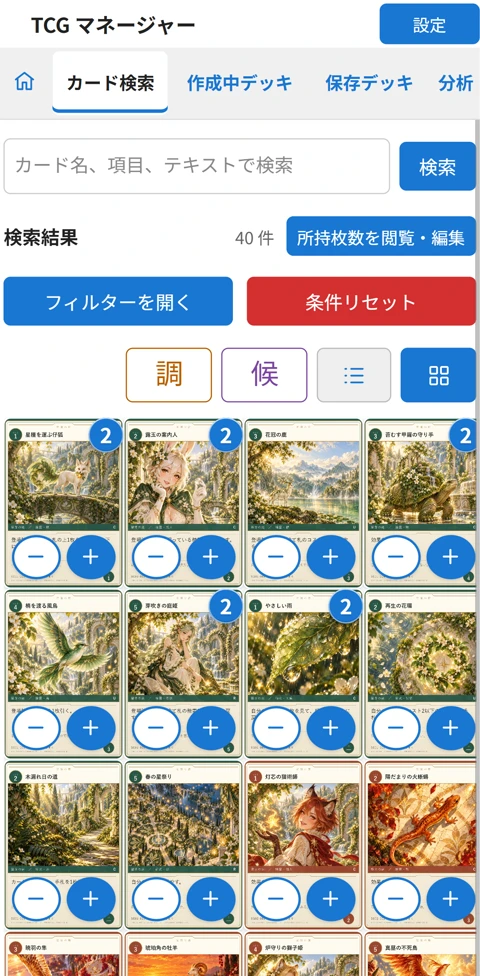
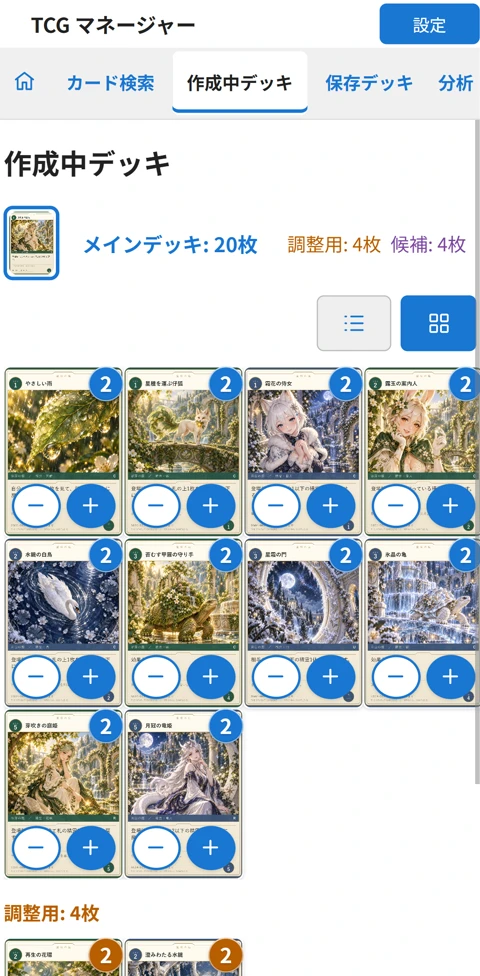

# TCG マネージャー

手持ちのカード画像やカード情報を取り込んで、複数のカードゲームの所持枚数・デッキ・戦績を一か所で管理するローカルアプリです。Windows版とAndroid版をBOOTHで配布しています。

[BOOTHの商品ページ](https://shikuto3194.booth.pm/items/8965497)

## スマートフォンでの操作画面

| カード検索 | デッキ構築 |
| --- | --- |
|  |  |

## できること

- カード画像やCSV・JSONを取り込み、ゲームごとに項目やセット名を設定する。
- 所持枚数を記録し、デッキの構築に必要なカードを確認する。
- メイン・サイドデッキを作成し、JSON・画像・印刷用PDFへ出力する。
- 対戦結果を記録し、ゲームやデッキごとに戦績を確認する。

## 設計の工夫

- **画像とゲーム情報を分けてローカルに保存する。** IndexedDBでストアを分け、カード画像に変更がなければ書き込みを省きます。ゲーム情報と画像をまとめてバックアップでき、旧形式の読み込みもテストしています。[ローカル保存](src/local) · [保存・移行のテスト](src/local/persistence.test.js)
- **保存と印刷を共通のデッキデータから扱う。** サイドデッキを含む構成を保存し、JSON・画像・PDFに出力します。PDFの処理は操作時に読み込み、初回の読み込みに混ざっていないことを検査します。[出力処理](src/local/exports.js) · [配布物の検査](scripts/check-distribution.mjs)
- **Webの画面をWindows・Androidでも利用する。** Reactの画面をTauriで配布し、ファイル操作などを端末側につなぎます。Windows版はMCP連携を備え、Android製品版で使える範囲はBOOTHの商品説明に記載しています。[Tauriのソース](src-tauri)

## 開発で担当したこと

個人開発として、目的と仕様の整理、AIへの実装指示、改善方針の判断、動作確認を担当しました。コード作成にはAIを活用しています。

**主な技術**　JavaScript、React、Vite、Tauri、Rust、IndexedDB、jsPDF

## Web版をローカルで確認する

Node.js 22.12以降の22系を使用します。

```sh
npm ci --ignore-scripts
npm run dev
```

公開用のソーススナップショットです。配布版の入手と利用条件はBOOTHの商品ページを参照してください。[第三者ライセンス](distribution/licenses)
